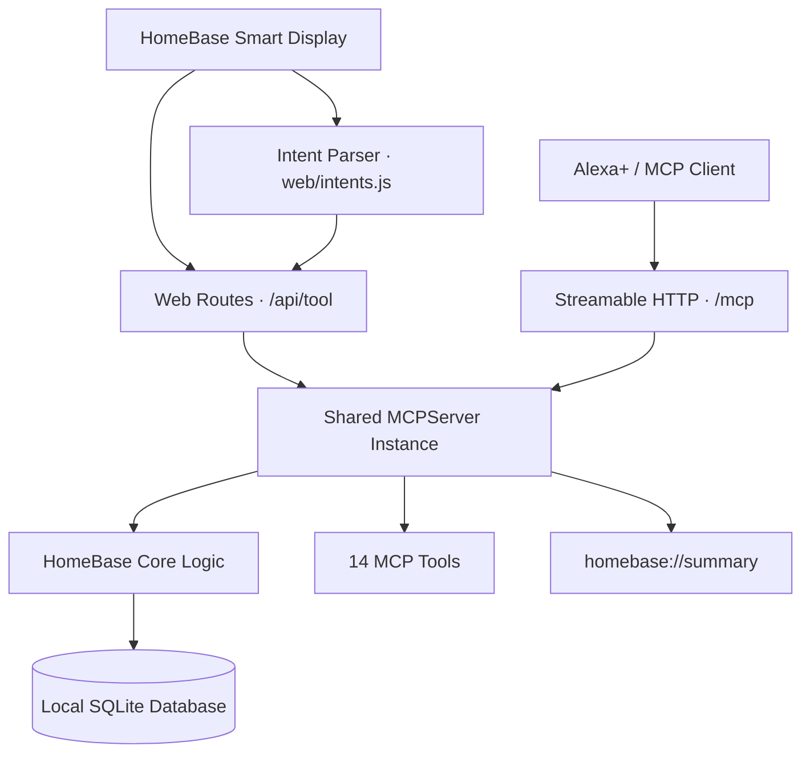

# 🏡 HOMEBASE — THE HOUSEHOLD, FINALLY IN SYNC.

  

  <strong>YOUR FAMILY'S CHIEF OF STAFF FOR ALEXA+</strong>
   
  A self-hosted MCP server that turns household chaos into coordinated action.
    
  
  
  
  

  <a href="#-the-idea">THE IDEA</a> &nbsp;•&nbsp;
  <a href="#-the-experience">THE EXPERIENCE</a> &nbsp;•&nbsp;
  <a href="#-under-the-hood">THE ARCHITECTURE</a> &nbsp;•&nbsp;
  <a href="#-get-it-running">GET STARTED</a>

---

> **Your home doesn't need another list. It needs a system that helps everyone stay in sync.**

Who's handling pickup at 5:30? Who has been doing all the chores? Can that meeting fit into Arjun's schedule? Are we out of eggs again?

These aren't isolated reminders. They're connected decisions that affect an entire household.

**HomeBase brings those decisions together.** It gives Alexa+ a shared household context through an open-source, self-hosted Model Context Protocol (MCP) server, backed by practical scheduling, workload-aware chore assignment, rotating pickup coordination, grocery tracking, and a spoken daily briefing.

And because a system should be experienced, not merely described, HomeBase also includes an interactive smart-display simulator where you can talk to it, see the schedule, and watch its tools in action.

  
  
  
  

## ✦ The idea

  

### A household is a team. Treat it like one.

HomeBase is designed around a simple principle: **good coordination means making decisions with the whole household in mind.**

| Everyday problem | What HomeBase does |
|---|---|
| Chores keep falling on the same person | Assigns chores based on workload |
| Pickup duty needs to be decided | Identifies eligible people and supports pickup assignment |
| Events clash on the calendar | Reports scheduling conflicts |
| Nobody remembers what's needed | Maintains a shared grocery list |
| Everyone asks what's happening today | Generates a daily briefing with a spoken response |
| A decision needs an explanation | Returns a `why` alongside relevant decisions |

The goal isn't to add more notifications to family life. It's to make the information and decisions behind everyday coordination accessible through one shared system.

## 🚀 The experience

  

### 01 / A shared family brain

Keep household members, chores, schedules, pickup assignments, and groceries connected to a shared data layer.

Instead of treating every request as an isolated question, HomeBase provides tools that operate on the household's stored information.

### 02 / Chores with workload in mind

Household responsibilities should not automatically land on whoever remembers them first.

- Add chores and assign them based on workload.
- Mark completed chores.
- Check chore status.
- Make household responsibilities easier to track.

### 03 / Scheduling that catches clashes

Plans only work when they fit together.

- Add household events.
- Retrieve today's schedule.
- Detect and report scheduling conflicts.
- Identify who can handle a pickup.
- Assign pickup responsibilities.

### 04 / One grocery list for everyone

No more separate mental inventories.

- Add grocery items.
- View the shared list.
- Mark items as bought.

### 05 / A briefing you can hear

HomeBase can generate a daily briefing with a `spoken` response, giving a voice-enabled interface a ready-to-speak summary.

The smart-display simulator supports microphone input in compatible browsers, typed requests, suggestion prompts, and spoken replies.

### 06 / Decisions with a reason

A result is more useful when people understand why it was chosen.

HomeBase returns explanations with relevant decisions. For example, a pickup recommendation can explain that someone is available and has handled fewer pickups.

**Not just an answer. Context behind the answer.**

---

## 🖥️ Meet the smart-display simulator

  

The simulator is a local, interactive way to experience HomeBase without requiring an actual Alexa+ device.

Once the server is running, open:

**http://127.0.0.1:8000/**

Inside the simulator, you can:

- **Explore the timeline:** See one lane per household member.
- **Spot scheduling conflicts:** Double-bookings appear as hatched overlaps.
- **Follow pickup assignments:** Assigned rides appear as dashed bars.
- **Talk or type:** Use the microphone in a supported browser, enter a request, or tap a suggestion.
- **Hear responses:** Toggle spoken replies on or off.
- **Inspect tool calls:** See which MCP tool handled a request.

The simulator's `/api/tool` endpoint dispatches into the same `MCPServer` instance exposed through `/mcp`. That means the interface exercises the actual HomeBase tool implementations rather than a separate set of mock tool responses.

The sentence-to-tool mapping is handled by a small deterministic parser in `web/intents.js`, helping keep demonstrations predictable.

### Give it something to do

Try these example requests in the simulator:

| Say or type | What to explore |
|---|---|
| `What's the plan today?` | Daily schedule and briefing |
| `Assign the 5:30 pickup for Kabir from football` | Pickup coordination |
| `Add a chore: vacuum the stairs` | Chore creation and assignment |
| `Schedule school meeting for Arjun at 4 pm` | Event creation and conflict handling |
| `Add eggs to the grocery list` | Shared grocery tracking |
| `Who has the most chores?` | Household workload information |

*Exact results depend on the current household data and the simulator's supported intent patterns.*

---

## ⚡ Under the hood

  

HomeBase exposes **14 MCP tools** across five household domains, alongside a summary resource.

| Domain | Tools | Purpose |
|---|---|---|
| Family | `add_family_member`, `list_family` | Manage household members |
| Chores | `add_chore`, `complete_chore`, `chore_status` | Create, assign, complete, and inspect chores |
| Schedule | `add_event`, `todays_schedule`, `who_can_pickup`, `assign_pickup` | Coordinate events and pickup duty |
| Groceries | `grocery_add`, `grocery_list`, `grocery_bought` | Manage the shared shopping list |
| Voice & demo | `daily_briefing`, `load_demo_family` | Generate briefings and load sample household data |

The server also exposes the `homebase://summary` resource.

### Built for understandable failures

Real systems need to handle invalid requests, not just successful demonstrations.

HomeBase raises readable MCP `ToolError` messages for anticipated problems, such as an unknown family member or an invalid time. This gives a voice interface useful feedback that can be communicated back to the user.

### The architecture

The separation keeps the core household logic distinct from the interface and protocol layer.

- `homebase/core.py` — household logic and SQLite persistence.
- `homebase/server.py` — MCP server and web routes.
- `web/` — smart-display interface and intent parsing.
- `scripts/` — scripted MCP client demonstration.
- `tests/` — Python and JavaScript tests.

## 🧰 Technology stack

  
  
  
  
  
  

| Technology
